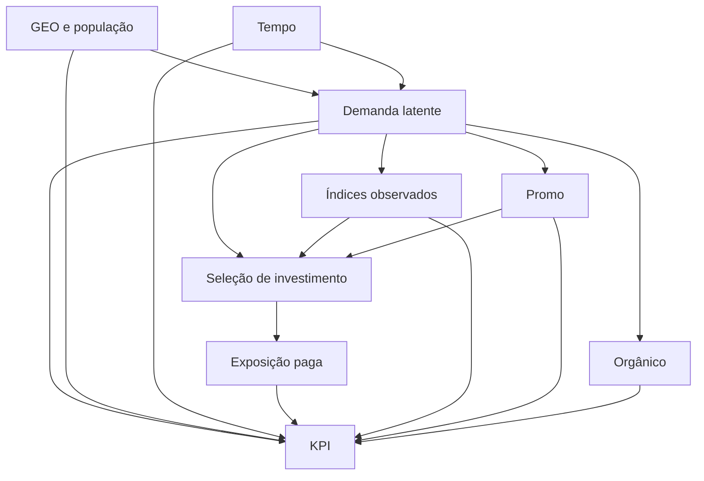

# Dos endereços observados a uma investigação verificável

**TCC de Marketing Mix Modeling com Google Meridian — Entrega 1 de 5.**

Este capítulo prepara a investigação; não apresenta um modelo estimado. A documentação da EDA anexada foi lida integralmente, incluindo epílogo e apêndices A–D. As referências a seus capítulos são referências ao anexo, não a arquivos de outros repositórios. Seu hash está em `data/metadata/provenance.json`. Nenhum outro repositório pessoal foi consultado. O guia da EDA é evidência narrativa; não tivemos acesso aos CSVs históricos de seus resultados nem a uma verdade causal da simulação.

A pergunta é: **em que medida a informação geotemporal, explorada por um MMM Bayesiano hierárquico, contribui para estimação, precisão e estabilidade dos efeitos incrementais de mídia em comparação com o nacional agregado?** Não pressupomos que GEO vencerá. A entrega termina no desenho, nas entradas e nas verificações estruturais; toda estimação fica para as entregas 2–5.

O caminho de leitura acompanha uma decisão de pesquisa: entender o que os dados permitem perguntar; explicitar o que deve ser assumido; escolher uma representação; reservar informação para avaliar essa escolha; definir quando continuar ou parar. Cada seção conecta investigação, evidência, intuição, formulação, escolha e limite.

## 1. O que passou da EDA para esta etapa

**O que investigaremos.** Queremos separar informação local útil de diferenças de tamanho e de ruído. Marketing Mix Modeling (MMM) relaciona um indicador de resultado, o KPI, à mídia e a outros fatores. GEO é o mercado acompanhado; aqui é artificial. Manter 40 endereços oferece mais contrastes, mas não equivale a ter 40 experimentos aleatórios.

**O que sabemos e por que decidir.** Nos capítulos 6–9 da EDA, a população acompanha fortemente o volume e permanecem movimentos locais depois de retirar médias de lugar e semana. Como numa escola em que turmas maiores produzem mais respostas no total, tamanho e comportamento não são a mesma coisa. Precisamos modelar a escala sem apagar a dinâmica local.

Formalmente, a decomposição exploratória separa diferenças entre médias geográficas, variação temporal comum e resíduos geotemporais. Ela não estima o contraste causal entre exposição observada e uma intervenção. A matriz abaixo é a ponte obrigatória para o desenho; as cifras são arredondadas da EDA, e uma auditoria estrutural selecionada foi recalculada nesta entrega.

| ID | Achado concreto e rótulo | Origem EDA | Limitação | Pergunta de modelagem | Implicação para configuração | Experimento posterior | Evidência para decidir |
|---|---|---|---|---|---|---|---|
| E01 | OBSERVADO NA EDA: população/KPI ≈0,97 | 6 | Escala não é efeito | O pooling distingue intensidade? | Entradas brutas e população única por GEO | GEO_HET | Contrastes em escala comum e shrinkage |
| E02 | OBSERVADO NA EDA: ≈68% between KPI | 8 | Nível persistente não causal | Interceptos acomodam níveis? | Interceptos GEO e scaling interno | G0 | PPC por GEO |
| E03 | OBSERVADO NA EDA: 65–79% de resíduo two-way per capita de mídia | 9 | Sobra pode ser ruído/endogeneidade | Há informação para efeitos? | Preservar painel sem residualizar entrada | GEO_NAT | Precisão e estabilidade em estimandos comuns |
| E04 | OBSERVADO NA EDA: sincronização mediana ≈0,03 | 7 | Correlação não prova independência | Há fatores comuns residuais? | Efeitos de tempo, diagnóstico espacial conceitual | K1–K4 | Resíduos por semana/GEO |
| E05 | OBSERVADO NA EDA: mix acumulado semelhante | 10–11 | Agregação apaga calendário | Ganho vem da dinâmica local? | Não interpretar mix como estratégia regional | GEO_NAT | Comparação controlada e limites |
| E06 | OBSERVADO NA EDA: C2 ≈64,3% zeros, ≈5,5% gasto | 12 | Pouco suporte local | Treino/teste contêm atividade? | Manter zeros e auditar cobertura | C2_SPARSE | Ativos, gasto, ESS por canal/GEO |
| E07 | OBSERVADO NA EDA: C3 ≈2,7% zeros, ≈40% gasto | 12/14 | Zero contrafactual pouco observado | Remover mídia exige extrapolação? | Manter canal e avaliar suporte | C3_CONTINUOUS | Sensibilidade ao baseline e saturação |
| E08 | OBSERVADO NA EDA: C2/C3 two-way ≈0,45 | 13 | Transformações mudam colinearidade | Contribuições se compensam? | Não remover por correlação | A1–A4/P1–P4 | Dependência posterior e estabilidade |
| E09 | OBSERVADO NA EDA: C4/concorrência ≈0,48 | 13 | Papel causal do controle desconhecido | Controle remove confusão ou mediação? | Incluir provisoriamente, sem certificado causal | C1 | DAG alternativo e sensibilidade |
| E10 | OBSERVADO NA EDA: controles com sinal | 2/13 | Índices sem unidade conhecida | São proxies pré-tratamento? | Preservar sinais, não dividir por população | C1 | Justificativa causal independente |
| E11 | OBSERVADO NA EDA: Promo contínuo, ≈47% zeros | 13 | Sem semântica de intensidade exata | Qual intervenção representa zero? | Tratamento não midiático, baseline proposto 0 | C3 | Suporte, prior e sensibilidade |
| E12 | AINDA NÃO IDENTIFICÁVEL: duração do efeito | 14 | Correlações defasadas não estimam memória | Oito semanas bastam? | max_lag=8 como referência | A1–A3 | Posterior/PPC, sem escolher pico de correlação |
| E13 | OBSERVADO NA EDA: extremos preservados | 16 | Não são erros demonstrados | Pontos dominam ajuste? | Sem corte ou winsorização | INFLUENCE | Refit omitindo um KPI por vez |
| E14 | OBSERVADO NA EDA: MeridianEDA contém REVIEW | 16 | Priors e configuração provisória | Alertas persistem no modelo? | Registrar ressalvas, não transformar em PASS | G0/G1 | Diagnósticos do ajuste futuro |
| E15 | AINDA NÃO IDENTIFICÁVEL: causalidade verdadeira | 18/Epílogo/D | Sem lift ou DGP conhecido | O que pode ser validado? | Separar previsão de causalidade | F0 | Transparência, não acurácia causal inventada |

**Escolha proposta:** baseline hierárquico com todos os canais e covariáveis, preservando a informação original. **Hipótese:** parte da dinâmica local melhora a precisão sem comprometer estabilidade. **Limite:** não há demonstração dessa hipótese. Na Entrega 2, essa matriz orientará a primeira posterior e sua revisão, sem decidir de antemão o resultado.

## 2. Perguntas, hipóteses e o que será medido

Investigar não é pedir ao modelo um ranking. É definir antes o contraste que o ranking tentaria resumir. Imagine comparar a mesma semana com o canal presente e ausente: só uma dessas histórias foi observada. O modelo fornece a segunda sob pressupostos; os dados não a revelam diretamente.

As perguntas secundárias e suas hipóteses operacionais são:

1. **Precisão:** os intervalos nacionais por canal derivados do GEO ficam menores? H0 operacional: nenhuma redução consistente; alternativa: redução com estabilidade e diagnósticos saudáveis. Intervalos estreitos isolados não significam acerto.
2. **Estabilidade:** medianas e intervalos sobrevivem a mudanças plausíveis de prior? Alternativa: mudanças materialmente grandes indicam identificação frágil.
3. **Heterogeneidade:** diferenças de resposta entre GEOs são atualizadas pelos dados ou reproduzem pooling e escala? Comparar prior/posterior e contrastes, sem interpretar volume como eficiência.
4. **Sparsity:** Channel2 tem incerteza e desempenho distintos entre estratos ativo/inativo? Descrever suporte sem interpretar os estratos como tratamento randomizado.
5. **Extrapolação:** atribuição a Channel3 muda com memória e saturação porque o contrafactual zero é pouco observado?
6. **Tempo:** flexibilidade temporal muda atribuição por absorver demanda comum? Comparar knots mantendo outros fatores fixos.
7. **Controles:** conclusões dependem do papel assumido para concorrência, sentimento, orgânico e Promo? Mudanças são evidência de sensibilidade, não prova de qual DAG é verdadeiro.
8. **Comparabilidade:** diferenças GEO/nacional persistem sob estimandos, escala, janela e validação compatíveis? Esta pergunta depende da resolução de H-COMP.

Definimos $g$ como mercado, $t$ como semana, $m$ como canal, $Y_{gt}$ como conversões simuladas, $x$ como trajetória de mídia, $s$ como gasto e $\theta$ como parâmetros. Seja $f_{gt}(x,z;\theta)$ a média condicional na escala original, mantendo covariáveis $z$. Para uma janela $W$,

$$
\Delta_{m,W}(\theta)=\sum_{g,t\in W}\{f_{gt}(x,z;\theta)-f_{gt}(x^{(-m)},z;\theta)\}.
$$

No contrafactual $x^{(-m)}$, o canal é zerado na janela de intervenção explicitada. História anterior, janela de contabilização e efeitos que ultrapassam suas bordas devem ser registrados. Não misturar “mídia executada no período” com “resposta ocorrida no período”. O horizonte inicial proposto é o painel de 156 semanas; a análise futura deve separar as primeiras oito semanas, pois não temos pré-história observada. Zero fora da janela não pode ser apresentado como fato histórico.

Todos os estimandos abaixo são **futuros**. A população de referência são os mesmos 40 mercados sintéticos, sem extrapolação para pessoas ou mercados reais. Intervalos serão calculados draw a draw, com mediana e credibilidade central de 90%; contrastes preservam covariância posterior.

| Estimando | Definição, unidade e agregação | Contrafactual/requisito | Saída esperada e restrição |
|---|---|---|---|
| Contribuição incremental | Δ por canal, GEO ou soma nacional; conversões no W | Zerar mídia, declarar história e suporte; ausência de confusão | `Analyzer.incremental_outcome`, explicitamente em KPI; não soma de quantis |
| Parcela incremental | Δ dividido pelo KPI total do W; fração | Denominador fixado e intervenção compatível | Contribuição normalizada; não participação de gasto, nem necessariamente decomposição causal exata com interações |
| Retorno em KPI/gasto | Δ / Σs; conversões por unidade de gasto | Unidade de spend preservada | Razão de draws; não chamar de retorno monetário |
| ROI monetário | Σ(r_gt Δ_gt) / Σs, r=receita por conversão | Receita e spend na mesma unidade, r válido sob intervenção | `Analyzer.roi` após validar semântica; razão de receita/gasto, não lucro líquido |
| mROI | Derivada ou diferença finita de receita esperada por gasto adicional | Fixar conversão gasto→impressão e distribuição GEO/tempo | `Analyzer.marginal_roi` ou contraste verificado na etapa futura; válido localmente, não promessa de retorno |
| Adstock | α e pesos de memória até L=8; α sem unidade, L em semanas | Família geométrica assumida; outras formas em A3 | Parâmetros de `inference_data.posterior`; memória causal não comprovada |
| Saturação | ec na escala transformada de exposição e slope sem unidade | Hill e suporte observado | Posterior de ec; slope=1 é fixo no baseline, não “estimado com precisão” |
| Efeitos GEO | β_gm e η_m; escala transformada/log conforme parametrização | Pooling e sinal assumidos | Posterior hierárquica; não comparar coeficientes brutos entre escalas |
| Contrastes GEO | Δ_gm por população ou por gasto, diferença entre GEOs | Mesmo horizonte e intervenção comparável | Draws conjuntos; não ranking de volumes nem prova de segmento comercial |
| Sensibilidade | Mudança de mediana e largura entre especificações | Mesmo alvo/janela/máscara | Tabelas futuras entre modelos; não Bayes factor automático |
| GEO versus nacional | Δ_nacional(GEO) − Δ_nacional(N0), larguras relativas | Agregação semântica e priors comparáveis | Comparação entre modelos separada da incerteza dentro de cada modelo |
| Incerteza | Intervalos, dispersão e dependência de parâmetros | Posterior saudável e especificação explicitada | Credibilidade condicional ao modelo; não inclui toda incerteza de DAG/DGP |

**Quatro níveis de afirmação:** ajuste preditivo descreve desempenho em observações; associação modelada descreve relações condicionais; identificação causal requer pressupostos adicionais; decisão de negócio exige ainda contexto, custos e validade externa. A EDA só sustenta os primeiros passos. Não podemos validar retorno real, causalidade externa ou erro frente a parâmetros verdadeiros que não foram fornecidos. Na Entrega 2, calcular apenas o que os gates permitirem; esta entrega não calcula nenhum estimando publicitário.

## 3. Um mapa causal que assume sua condição de hipótese

Um DAG é um grafo acíclico dirigido: as setas representam causas propostas, não correlações descobertas. Serve como o mapa de encanamento antes de tentar atribuir a água a cada torneira. A EDA dos capítulos 13–16 alerta que canais e controles caminham juntos, mas não orienta as setas.

Este é **um DAG hipotético**, não um conjunto de ajustes causalmente certificado. Demanda pode orientar targeting e aumentar o KPI. Controlar proxies imperfeitos pode deixar confundimento residual. Em DAGs alternativos, publicidade pode afetar sentimento, concorrência ou orgânico: condicioná-los então pode bloquear mediação ou abrir caminhos de collider. Essas setas alternativas não são combinadas indiscriminadamente com o desenho acima. Definir “efeito total” versus “direto condicionado” depende desse mecanismo.

Promo permanece contínuo, com zero como referência proposta de ausência de intervenção; seu nome não prova que zero significa ausência real. População mede escala, não tratamento. Tempo acomoda demanda comum, mas não representa automaticamente todos os feriados ou choques. Não há identificação de paid search nos canais anônimos, portanto não se inventa um controle de consultas.

| Pressuposto | Status | Evidência disponível | Risco se violado | Avaliação posterior |
|---|---|---|---|---|
| Consistência da intervenção | unknown | Impressões/gasto identificados, plataformas anônimas | Mesma exposição pode representar intervenções distintas | Explicitar política de gasto→mídia e limitações |
| Ausência de confundimento condicional | unsupported | Sem randomização ou lift | Atribuição enviesada apesar de bom ajuste | DAGs alternativos, sensibilidade; não prova pela posterior |
| Positividade/suporte | partially assessable | Zeros, intensidade e atividade por GEO | Contrafactual fora do observado | C2_SPARSE/C3_CONTINUOUS |
| Não interferência entre mercados | unknown | GEOs artificiais sem relações espaciais | Spillovers confundem efeitos locais | Assumir para baseline, declarar incapacidade de testar spillover real |
| Medição válida | partially assessable | Painel/pares/bytes validados | Erros de medida distorcem resposta | Auditoria numérica não certifica processo gerador |
| Estabilidade temporal de parâmetros | assumed | Três anos de observações | Efeito médio mistura regimes | Resíduos temporais e sensibilidades, sem inventar campanhas |
| Índices são ajustes pré-tratamento | unknown | Nomes e correlações apenas | Sobreajuste causal, mediação, collider | C1 e DAGs alternativos |
| Promo é intensidade não extensiva | assumed | Contínua, zeros, sem unidade | Scaling/baseline inadequados | Revisar semântica e contraste |
| Forma aditiva e Hill/adstock adequada | assumed | Lags inconclusivos | Interações e memória mal especificadas | A1–A4, PPC |
| Erros condicionais adequados | assumed | EDA não ajustou likelihood | Incerteza excessivamente estreita | PPC, resíduos e heteroscedasticidade |

Na Entrega 2, a hipótese causal continua uma hipótese, mesmo se a amostragem convergir. A ausência de experimento de lift é uma limitação substantiva que não se resolve aumentando o número de draws.

## 4. A matéria-prima e seu contrato

Queremos saber se estamos configurando o mesmo tipo de painel descrito na EDA. A analogia é conferir o lote antes de cozinhar: não basta reconhecer o rótulo. O arquivo oficial foi recuperado no commit `02111531f8661373aa7b6ba31c316c67d72d1dd2`, caminho `meridian/data/simulated_data/csv/geo_all_channels.csv`. O Git blob `855e25fe5f76cc895d458f456f7a1d45ba5d87b8` foi reproduzido a partir dos bytes. SHA-256: `d9ee016f7cd21f5c90b50da10a794af91a372b69f881d3caa266edd41fdafbf6`. São **966.498 bytes, 6.240 linhas e 20 colunas físicas**, incluindo o índice exportado.

A estratégia A versiona a cópia oficial pequena e seu LICENSE Apache-2.0. Os bytes não são reexportados por pandas. Na cópia analítica, remove-se exclusivamente `Unnamed: 0` após verificar a sequência 0…6239; restam 19 colunas. A ordem canônica é Geo0…Geo39 e datas crescentes. Hash alterado bloqueia a execução; não há fallback para `main` nem troca silenciosa de base.

O snapshot upstream e a release selecionada indicam `2.1.0`, mas isso **não identifica retrospectivamente a versão do gerador da simulação**. O anexo não contém o hash da cópia histórica da EDA. Assim, confirmamos correspondência estrutural e indicadores selecionados; identidade byte a byte com a cópia histórica permanece REVIEW. O commit da release da API é outro: `cb0be8fe454124aadb73222c579f081f8823edfd`. Não confundir snapshot de dados, versão instalada e versão original do processo gerador.

| Coluna física/grupo | Tipo/domínio | Papel Meridian | Unidade e política |
|---|---|---|---|
| Unnamed: 0 | Inteiro sequencial | Nenhum | Índice verificado, removido só da cópia |
| geo | Texto, Geo0…Geo39 | geo | Mercado fictício, sem coordenadas reais |
| time | ISO YYYY-MM-DD, passos de 7 dias | time/media_time | 156 semanas de 2021-01-25 a 2024-01-15 |
| conversions | Numérico finito ≥0, admite frações | kpi | Conversões simuladas; não arredondar |
| population | Numérico >0, constante por GEO | population | Escala de mercado; somar uma vez por GEO |
| Channel0…4_impression | Cinco colunas numéricas ≥0 | media, cinco canais | Exibições, não reach; zeros preservados |
| Channel0…4_spend | Cinco colunas numéricas ≥0 | media_spend | Unidade monetária não identificada; pares alinhados pelo nome |
| Organic_channel0_impression | Numérico ≥0 | organic_media | Exposição sem gasto pago associado |
| competitor_sales_control | Numérico com sinais | controls | Índice sintético; não vendas reais nem moeda |
| sentiment_score_control | Numérico com sinais | controls | Índice sintético; média perto de zero não justifica CV |
| Promo | Numérico ≥0, contínuo | non_media_treatments | Intensidade proposta; não binarizar |
| revenue_per_conversion | Numérico >0 | revenue_per_kpi: não ativado | Coluna preservada; monetização secundária pendente |

Audita-se unicidade, painel completo, ausências, finitude, domínios, população, pares de zeros e preservação dos valores. Reconciliação de somas usa rtol=1e-12 e atol=1e-8; reconciliação de tensores aceita rtol=2e-6 e atol=1e-6 para precisão interna. Nenhuma tolerância autoriza arredondar conversões ou corrigir dados. Os pontos Geo23/2022-02-28 e Geo36/2023-08-14 continuam intactos.

A auditoria reproduziu população/KPI **0,969334**, between KPI **0,678882**, zeros C2 **0,642628**, zeros C3 **0,027083** e zeros Promo **0,468269**. As frações de gasto C2/C3 são **0,055033 / 0,400289**. São compatíveis com o arredondamento do guia, conforme `eda_reconciliation.json`; não refizemos a EDA inteira. Na Entrega 2, a mesma fonte e contrato devem preceder qualquer inferência.

## 5. A representação GEO inicial e a API que realmente executou

A ideia hierárquica é compartilhar informação sem obrigar todos os mercados a responder igualmente. Uma representação esquemática, no espaço transformado pelo Meridian, é:

$$
\widetilde Y_{gt}\sim\mathcal N\left(\tau_g+\mu_t+\sum_m\beta_{gm}h_m(a_m(\widetilde x_{g\cdot m})) + \beta_{go}h_o(a_o(\widetilde o)) +\sum_j\gamma_{gj}\widetilde c_{gtj}+\gamma_{gn}\widetilde p_{gt},\sigma_g^2\right).
$$

Aqui τ é o nível GEO, μ o efeito temporal, β a resposta à mídia, γ o efeito linear de controles/Promo e σ a dispersão residual. Esta equação é explicativa; detalhes de centralização e reparametrização obedecem ao código oficial fixado. A **likelihood** é a densidade dos dados condicionada aos parâmetros. A **prior** distribui plausibilidade antes de aprender os parâmetros; a **posterior** resulta da atualização. Não arredondar conversões é compatível com o uso de uma likelihood contínua, não de uma contagem Poisson.

**Adstock** carrega exposição para semanas seguintes: geometricamente, pesos são proporcionais a α^l, l=0…L, normalizados pela implementação. **Hill** representa saturação: h(a)=a^s/(a^s+ec^s), com ec como meia saturação e s como inclinação. O baseline usa L=8, Hill depois de adstock e slope fixo em 1. É um ponto inicial verificável, não uma duração descoberta pelos lags da EDA.

**Population scaling** é a transformação interna que considera o tamanho de mercado. Entramos com volumes brutos, não com os dados por mil habitantes explorados anteriormente. Dividir duas vezes por população alteraria o problema. Controles e Promo ficam sem divisão populacional: tratá-los como índices/intensidade é hipótese explícita, não conclusão dos nomes.

**Knots** são pontos que parametrizam a trajetória temporal. Com `knots=None` e AKS desligado, o GEO resolve 156 knots; o nacional resolveria apenas um. **AKS**, seleção automática de knots, é alternativa futura, e seu uso deve verificar se não utiliza KPI reservado. Deixar defaults nos dois modelos não é controlar a flexibilidade temporal.

A configuração técnica está em `baseline_geo.yaml`, com status e motivo por parâmetro, herdando a URL de fonte do documento. Usa `media_effects_dist=log_normal`, impondo efeitos de mídia positivos; isso exclui efeitos negativos do baseline e deve ser reconhecido. `unique_sigma_for_each_geo=False` impõe uma escala residual comum no espaço transformado. `baseline_geo=None` deixa a referência ser o GEO de maior população, uma convenção de identificação, não o mercado “melhor”. Os cinco canais pagos, o orgânico, os dois controles e Promo entram explicitamente.

Na instalação real **google-meridian 2.1.0**, construímos `CoordToColumns`, `DataFrameDataLoader`, `InputData`, `PriorDistribution`, `ModelSpec`, `HoldoutSpec`, `GeoHoldoutSpec` e `DateRange`, e inicializamos `Meridian` sem amostragem. A inspeção conferiu os tensores: KPI 40×156, mídia/gasto 40×156×5, controles 40×156×2, orgânico/Promo 40×156×1, população 40. Os valores foram reconciliados célula a célula com coordenadas da API.

A docstring de carregamento usa `non-revenue`, mas a validação real exige **`non_revenue`**. A primeira tentativa falhou e foi corrigida; não se mascarou o erro como teste aprovado. `paid_media_prior_type` e `holdout_id` são caminhos depreciados: o código usa `media_prior_type` e holdout declarativo. O teste compara a máscara materializada com a máscara efetivamente resolvida pelo modelo. A igualdade de código instalado com a release foi conferida por texto normalizado nos arquivos centrais, com hashes registrados; não se afirma igualdade binária após normalização de finais de arquivo.

Na Entrega 2, será necessário verificar também os objetos derivados usados na inferência, o custo de compilação e a geometria posterior. Inicializar estrutura não prova convergência, desempenho ou bom ajuste.

## 6. Priors: suposições visíveis, sem inventar experiência de negócio

A prior é como definir limites de plausibilidade antes de medir. Limites muito apertados podem produzir respostas estáveis por construção; muito largos podem produzir situações absurdas. A EDA não fornece ROI histórico nem lift. Por isso o baseline usa defaults identificados, com revisão obrigatória, sem fingir que são conhecimentos comerciais.

Escolhemos **contribution** para mídia paga, evitando impor uma prior de receita/gasto numa moeda sem semântica validada. O default Beta(1,99) por canal tem média 1% e pode regularizar fortemente: cinco canais pagos não formam automaticamente uma distribuição conjunta de composição. Não é uma prior “neutra”. O alerta emitido pelo `InputData` sobre contribuição total com p_mean=0,4 é genérico para KPI não monetário sem receita. No contexto do modelo, esse fallback é ativado para ROI default; a configuração explícita de contribuição paga usa `contribution_m`. A interpretação deste aviso foi preservada nos logs, não ocultada.

| Grupo | Distribuição/hiperparâmetros verificados | Suporte/unidade | Motivação e risco | Experimento futuro |
|---|---|---|---|---|
| contribution_m | Beta(1,99), por canal | (0,1), fração de KPI | Default, forte concentração perto de zero; dependência da definição de janela/KPI | P1/P2 |
| roi_m, inativo | LogNormal(loc=0,2; scale=0,9) | >0, unidade do outcome/gasto | Não utilizado; loc/scale são no log, não média/DP originais | P3 após validar unidade |
| mroi_m, inativo | LogNormal(0;0,5) | >0, retorno marginal | Não utilizado; pressupõe política de gasto/exposição | P3 ou extensão futura separada |
| contribution_om | Beta(1,99) | (0,1), fração | Orgânico não tem spend; risco de sufocar contribuição | P4 |
| contribution_n (Promo) | Normal truncada(0;0,1; −1;1) | [−1,1], fração com sinal | Zero como baseline, efeito pode ser negativo | C3 e sensibilidade própria se necessário |
| gamma_c | Normal(0;5) | Real, coeficiente no espaço transformado | Controles com sinal; scale=5 pode ser amplo | C1 e PPC |
| xi_c / xi_n | HalfNormal(5) | ≥0, dispersão hierárquica | Heterogeneidade dos efeitos; dependente da escala | GEO_HET/extensão específica |
| tau_g_excl_baseline | Normal(0;5) | Real, KPI transformado | Níveis geográficos; referência tem parametrização distinta | PPC por GEO |
| knot_values | Normal(0;5) | Real, KPI transformado | Flexibilidade temporal não é sazonalidade conhecida | K1–K4 |
| sigma | HalfNormal(5) | ≥0, DP do KPI transformado | Resíduo comum; risco de dispersão exagerada | PPC e sensibilidade de sigma |
| eta_m / eta_om | HalfNormal(1) | ≥0, dispersão na hierarquia de mídia | Pooling; log_normal implica positividade | GEO_HET |
| alpha_m / alpha_om | Uniform(0,1) | [0,1], decaimento sem unidade | L=8 limita a memória, independentemente de alpha | A1–A3 |
| ec_m / ec_om | Normal truncada(0,8;0,8;0,1;10) | [0,1;10], exposição transformada | Meia saturação, não impressões brutas | A4 e PPC |
| slope_m / slope_om | Deterministic(1) | {1}, sem unidade | Não estimado no baseline | Sensibilidade futura isolada se indicada |
| beta_m / beta_om / gamma_n, inativos como priors diretas | HalfNormal(5) / HalfNormal(5) / Normal(0;5) | Escala de coeficientes | Existem no objeto, mas contribuição define a parametrização ativa | Não interpretar inventário como uso de todas as distribuições |

O inventário executado inclui parâmetros de R&F porque a classe os define. **Não há dados R&F nem canais R&F no modelo.** Não deduzimos alcance único ou frequência de impressões.

**Prior predictive checks da Entrega 2:** simular antes da posterior, em escala de KPI original, e examinar distribuição de totais, valores negativos, baseline, contribuição conjunta e curvas no suporte observado. Critérios de triagem propostos: quaisquer valores não finitos bloqueiam; mais de 5% de predições negativas ou totais nacionais além de dez vezes a escala observada motivam REVIEW, não truncamento; baseline frequentemente negativo e contribuição conjunta incompatível com a interpretação exigem revisão; saturação quase total em toda a faixa ou ausência de resposta dentro dela exigem revisão. Esses limites são guardrails de escala, não evidência comercial, e devem ser registrados antes da simulação. Não se ajusta a prior para produzir ROI desejado.

É preciso distinguir uma prior com distribuição fixa de uma parametrização de contribuição que depende de escala observada. O uso do KPI em normalização/calibração pode tornar a validação parcialmente dependente do conjunto completo. Essa auditoria adicional é gate antes de alegar avaliação estritamente fora da amostra. Nenhuma amostra prior predictive foi gerada aqui.

## 7. Reservar células não é reservar a mesma pergunta

Holdout é a parcela cujo KPI é retirado da likelihood. Como reservar questões para conferir o aprendizado, ele só é justo quando não reaparece disfarçado no material de treino. No Meridian, a mídia permanece disponível: ela afeta o adstock em semanas seguintes. Portanto, esta validação é condicional à exposição observada, não forecasting prospectivo.

**H-GEO:** usamos 15% das células, seed 20261025, algoritmo `hash-cycle-v1`. Ordenam-se GEOs e semanas por SHA-256 de seed e identificador; atribuem-se seis posições geográficas consecutivas em ciclos por semana permutada. Esse desenho distribui 936 células entre 40 mercados: 23 ou 24 por GEO e exatamente seis por semana. Não usa `conversions`, não procura a seed com melhor resultado e persiste todas as 6.240 decisões booleanas. Os testes verificam invariância à ordem das linhas e à alteração arbitrária do KPI.

Sob esse desenho há 5.304 células de treino e 936 de teste, com 34 mercados observados por semana. A máscara declarativa da API resolve exatamente as mesmas células. O balanceamento é uma garantia de coordenadas, não uma garantia de equilíbrio da mídia.

As tabelas registram por GEO, semana e canal: n, ativos/inativos, exposição e gasto. Todos os canais têm atividade em ambos os conjuntos de cada GEO. Mesmo assim, há seis alertas de Channel2: diferenças de atividade acima de 20 pontos percentuais em Geo13, Geo29 e Geo9; fração de gasto teste abaixo de 5% em Geo29 (≈4,82%) e Geo32 (≈4,97%); acima de 30% em Geo9 (≈30,95%). São limites ex ante do desenho, não testes de causalidade. Mantemos a máscara e o status REVIEW; a Entrega 2 deve evitar interpretar desempenho desses mercados sem esse contexto. Qualquer proposta de estratificação futura deve usar apenas mídia/coordenadas, registrar nova versão e não comparar resultados em máscaras diferentes como se iguais.

**H-COMP:** permanece `PENDING_METHOD_DECISION`. Se algumas células GEO estão reservadas mas o nacional é treinado com a soma completa da mesma semana, seus KPIs estão dentro do treino nacional. Isso é vazamento. Tampouco é válido comparar R² de 6.240 células com R² de 156 somas.

Candidato futuro: reservar cerca de 10% de semanas internas não contíguas, iguais para ambos os modelos, mantendo as bordas no treino. Porém, retirar os 40 KPIs de uma semana deixa seu knot GEO sem informação direta quando há um knot por semana. A interpolação e a prior passam a dominar essa parcela. Antes de implementar, justificar uma base temporal com suporte no treino, auditar seleção de knots/AKS, scaling e priors dependentes do KPI, congelar a regra de agregação e definir métricas sobre as mesmas somas nacionais. Não executamos nem aprovamos esse desenho nesta entrega.

Alternativas: comparar estimandos nacionais sem chamar de teste preditivo; estudar H-COMP com knots pré-fixados e interpoláveis; ou separar uma comparação operacional de defaults de uma comparação controlada. Nenhuma dessas escolhas permite atribuir automaticamente toda diferença à granularidade. Na Entrega 2, H-GEO serve ao diagnóstico GEO; a comparação justa permanece assunto da Entrega 4.

## 8. O nacional precisa preservar significados, não só somas

A EDA (capítulo 16) mostrou que somar índices e calcular médias populacionais produz perguntas diferentes. Como juntar notas de turmas: soma de alunos faz sentido; soma de uma nota média não representa a média da escola. Assim, o plano nacional é formal e provisório; nenhum modelo nacional foi instanciado.

Para cada semana: Y_t=Σ_g Y_gt; mídia, orgânico e gasto são somados; população P_t=Σ_g P_g, uma vez por GEO, não pelas 156 repetições. Deve-se verificar P_t constante, reconciliar totais e manter 156 datas. Receita agregada R_t=Σ_g r_gt Y_gt e receita média por conversão r_t=R_t/Y_t, quando Y_t>0; não usar média simples de r. Mesmo essa identidade contábil não comprova invariância de r sob intervenção.

Para `competitor_sales_control` e `sentiment_score_control`, a proposta é média ponderada pela população, ΣP_g c_gt/ΣP_g, **se** representarem índices de intensidade. Se a definição for extensiva, soma pode ser coerente; se amostral, seriam necessários pesos da amostragem. Não há informação que resolva isso. `Promo` usaria média populacional sob a hipótese de intensidade e baseline zero; soma corresponderia a outra definição de tratamento. Preservar sinal e continuidade em todas as opções.

A não linearidade impõe outra diferença: em geral Σ_g Hill(adstock(x_g)) não é Hill(adstock(Σ_g x_g)). Agregação e transformação não comutam. Padronização, pooling e priors também mudam. A comparação controlada deve declarar o que conseguiu igualar e o que é inerentemente diferente; a operacional pode comparar defaults, mas não isola apenas o efeito de preservar GEOs. Na Entrega 4, métricas nacionais e intervalos somados draw a draw serão usados no mesmo horizonte, após resolver essas hipóteses.

## 9. Experimentos e regras para continuar ou parar

MCMC é amostragem por cadeias de Markov, utilizada para aproximar a posterior; NUTS é um algoritmo dessa família. Nenhuma dessas rotinas foi chamada. O registro YAML contém 25 experimentos, todos `planned`, com hipótese, comparador, fator alterado, fatores fixos, risco, saída e gate. Não é uma lista para executar automaticamente.

A sequência é `data_ready → spec_ready → sampling_healthy → fit_reviewed → inference_reviewed → optimization_eligible`. Nesta etapa só verificamos os dois primeiros em sentido técnico; prontidão científica continua REVIEW. G0/G1 pertencem à Entrega 2; priors, memória, tempo, controles, esparsidade e influência à 3; N0/GEO_NAT à 4; F0/O0 à 5. O registro limita mudanças a um fator interpretável por comparação; N0/GEO_NAT explicitam as mudanças inevitáveis de unidade, hierarquia e flexibilidade. INFLUENCE testa um extremo por execução, nunca apaga os dois de forma cumulativa.

| Gate/diagnóstico futuro | Critério proposto antes de observar resultados | Ação |
|---|---|---|
| Integridade | Fonte, painel, tensores e máscara conformes | Qualquer falha BLOCKED |
| Sampling | Pelo menos quatro cadeias; R-hat <1,01, bulk e tail ESS ≥400 nos alvos, traces sem separação | Pausar e revisar; não otimizar mídia |
| Divergências/energia | Zero divergências como meta quando expostas pelo backend; se não expostas, registrar indisponibilidade | Não converter ausência de diagnóstico em zero |
| Precisão Monte Carlo | MCSE pequena, alvo ≤5% da DP posterior para estimandos centrais | Aumentar precisão só após revisar geometria |
| PPC | KPI, caudas, zeros previstos, baseline e resíduos por GEO/tempo sem falhas sistemáticas graves | REVIEW com localização e causa proposta |
| Ajuste | R², wMAPE=Σabs(y−ŷ)/Σabs(y), MAPE só com denominadores positivos | Mesma unidade/máscara; não certifica causalidade |
| Incerteza preditiva | Cobertura de intervalo de 90% com incerteza amostral; desvios >10pp são alerta exploratório | Investigar heterogeneidade e misspecification |
| Sensibilidade | Mudança de mediana >20% quando referência longe de zero, ou >0,5 DP combinada | REVIEW; perto de zero evitar percentuais instáveis |
| Precisão GEO/nacional | Largura menor em alvo comum, sem perda de estabilidade e sob especificações comparáveis | Evidência pode favorecer qualquer modelo ou ser inconclusiva |
| Inferência | Suporte, priors atualizadas, incerteza e pressupostos discutidos | Sem isso, sem interpretação causal assertiva |
| Otimização | F0 congelado, gates anteriores, unidade e extrapolação revisadas | Apenas cenários sintéticos; nunca recomendação de campanha real |

Intervalos menores podem ser fruto de prior mais forte, não informação superior. R² maior pode resultar de mais parâmetros. A evidência de ganho GEO deve combinar precisão, estabilidade e diagnóstico, com as diferenças de modelo explicitadas. Sem verdade-terreno fornecida, não se estima cobertura causal real nem viés frente ao efeito verdadeiro.

Na Entrega 2, primeiro prior predictive e revisão, depois inferência autorizada daquela etapa. Não se busca automaticamente o modelo com ROI mais alto, mais positivo ou mais conveniente.

## 10. Execução, evidências e fronteiras

A execução única é `python -m src.run_stage1`, a partir da raiz. Ela verifica bytes, contrato, auditorias, máscara, objetos Meridian e escreve um manifesto com versões e hashes. `python -m pytest -q` testa falhas físicas introduzidas, imutabilidade, máscara, cobertura, integridade do notebook e a API. `--without-api` existe para auditoria parcial e registra `spec_ready=BLOCKED`, nunca substitui o teste completo.

O notebook principal reproduz a sequência com texto e código separados, usando caminhos relativos. Suas células foram executadas sequencialmente via IPython no mesmo processo Python. As tentativas de kernel Jupyter via nbclient foram bloqueadas pelas restrições de sockets TCP/IPC do ambiente; portanto não se afirma validação de kernel. No Colab, abre-se o notebook pelo link do README, executa-se a célula de preparação, instala-se o ambiente fixado e reinicia-se a sessão se o instalador solicitar; em seguida executam-se todas as células. A referência do código pode ser fixada ao SHA de entrega informado no histórico. O manifesto local não comprova uma sessão hospedada.

**Status Colab: `NOT_TESTED_IN_HOSTED_COLAB`.** Para encerrá-lo: abrir em sessão limpa, registrar data/Python/versões, executar tudo sem editar outputs, conferir PASS técnico e alertas REVIEW, executar pytest e salvar manifesto e notebook resultantes. Não basta importar Meridian. Não há dependência do Drive, token, GPU ou serviço pago.

O quadro de aceitação em `outputs/tables/acceptance.csv` separa evidência e pendência por requisito. `run_manifest.json`, `api_validation.json`, inventário das priors, cobertura e logs são evidência computacional; o presente texto e os YAMLs são o protocolo científico. O registro de ambiente fixado acompanha os arquivos para reprodução.

### O que o Codex NÃO fez nesta entrega

Não executou posterior, MCMC, NUTS ou amostragem de priors. Não estimou contribuição incremental, ROI, mROI, efeitos por GEO ou curvas de resposta. Não ajustou nem instanciou um MMM nacional. Não otimizou orçamento, não transformou impressões em R&F, não arredondou conversões, não removeu extremos e não atribuiu canais a plataformas. Não acessou outros repositórios pessoais, não mudou visibilidade nem iniciou a Entrega 2.

**Pendências para revisão antes da Entrega 2:** avaliar quão restritiva é Beta(1,99); revisar baseline e escala de Promo/controles; considerar suporte local de C2 e extrapolação de C3; auditar dependência do KPI reservado em transforms/priors; reconhecer ausência de pré-história; validar no Colab. H-COMP, unidades monetárias e agregação de índices permanecem decisões para etapas posteriores e bloqueiam as respectivas interpretações, não a auditoria da etapa 1.

## 11. Fontes e rastreabilidade

Consultadas em 25/10/2026, somente fontes oficiais públicas. Páginas online podem evoluir: a implementação executável foi confrontada com a release fixada e com o pacote instalado.

- [Modelo e equação](https://developers.google.com/meridian/docs/advanced-modeling/model-spec).
- [Configuração do modelo](https://developers.google.com/meridian/docs/user-guide/configure-model).
- [Holdout e limitações](https://developers.google.com/meridian/docs/advanced-modeling/holdout-observations).
- [Knots e AKS](https://developers.google.com/meridian/docs/advanced-modeling/setting-knots).
- [ModelSpec da release](https://github.com/google/meridian/blob/cb0be8fe454124aadb73222c579f081f8823edfd/meridian/model/spec.py).
- [Priors da release](https://github.com/google/meridian/blob/cb0be8fe454124aadb73222c579f081f8823edfd/meridian/model/prior_distribution.py).
- [Carregamento da release](https://github.com/google/meridian/blob/cb0be8fe454124aadb73222c579f081f8823edfd/meridian/data/load.py).
- [Contexto do modelo: ativação das priors](https://github.com/google/meridian/blob/cb0be8fe454124aadb73222c579f081f8823edfd/meridian/model/context.py).
- [CSV oficial imutável](https://raw.githubusercontent.com/google/meridian/02111531f8661373aa7b6ba31c316c67d72d1dd2/meridian/data/simulated_data/csv/geo_all_channels.csv).

A evidência EDA é o anexo `EDA_DIDACTIC_GUIDE.md`, especialmente capítulos 2–3, 6–16, 18, epílogo e apêndice D. Links históricos presentes no anexo não foram seguidos para outros repositórios do usuário.
